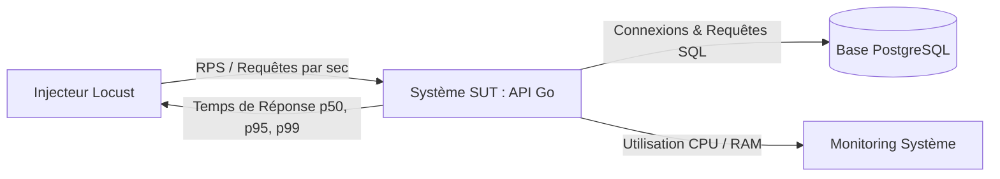

# Guide Complet et Réutilisable : Tests de Charge et de Performance avec Locust

> **Auteur :** Modou GUEYE (Équipe Technique)  
> **Version :** 1.0.0 — Août 2026  
> **Portée :** Guide méthodologique, technique et opérationnel, réutilisable sur tous projets d'API / Microservices (Fintech, Banking, E-commerce, etc.).

---

## Sommaire

1. [Introduction et Principes Fondamentaux](#1-introduction-et-principes-fondamentaux)
2. [Pourquoi Locust ? (Comparatif et Atouts)](#2-pourquoi-locust--comparatif-et-atouts)
3. [Architecture Réutilisable d'un Projet de Test](#3-architecture-réutilisable-dun-projet-de-test)
4. [Guide de Développement de Scénarios Locust](#4-guide-de-développement-de-scénarios-locust)
5. [Gestion de l'Authentification et Données Dynamiques](#5-gestion-de-lauthentification-et-données-dynamiques)
6. [Modes d'Exécution (Web UI, Headless, Distribué)](#6-modes-dexécution-web-ui-headless-distribué)
7. [Analyse des Métriques et Diagnostic de Goulots](#7-analyse-des-métriques-et-diagnostic-de-goulots)
8. [Modèle de Rapport de Synthèse pour la Direction](#8-modèle-de-rapport-de-synthèse-pour-la-direction)
9. [Checklist et Adaptabilité à d'Autres Projets](#9-checklist-et-adaptabilité-à-dautres-projets)

---

## 1. Introduction et Principes Fondamentaux

### 1.1 Qu'est-ce qu'un Test de Charge ?
Un test de charge consiste à soumettre un système logiciel (API, base de données, infrastructure) à une demande simulée pour mesurer son comportement, sa stabilité et ses temps de réponse sous divers volumes de trafic.

### 1.2 Les Différents Types de Tests de Charge

| Type de Test | Objectif | Profil de Trafic |
| :--- | :--- | :--- |
| **Smoke Test (Validation)** | Vérifier que le script de test fonctionne et que l'API répond sans erreurs fonctionnelles. | 5 à 10 utilisateurs virtuels pendant 30s à 1min. |
| **Load Test (Charge nominale)** | Valider le respect des SLAs sous le trafic moyen ou de pointe attendu. | Montée progressive jusqu'au trafic cible, maintien 10-30 min. |
| **Stress Test (Point de rupture)** | Déterminer la capacité maximale du système et observer comment il dégrade ses services. | Augmentation continue jusqu'à apparition d'erreurs (500, timeouts). |
| **Spike Test (Pic soudain)** | Évaluer la résilience face à une affluence subite (ex: campagne marketing, virement de salaires). | Passage instantané de 10 à 500+ utilisateurs en quelques secondes. |
| **Soak / Endurance Test** | Détecter les fuites mémoires, saturations de disque, ou épuisements de pools de connexions sur la durée. | Charge constante modérée pendant plusieurs heures (ex: 500k transactions). |

### 1.3 Les Métriques Cardinales à Surveiller



* **RPS (Requests Per Second) / Débit :** Nombre de requêtes HTTP traitées avec succès par seconde.
* **Latence Médiane (p50) :** 50% des requêtes ont un temps de réponse inférieur à cette valeur.
* **Percentiles 95 et 99 (p95 / p99) :** Indiquent l'expérience des requêtes les plus lentes (ex: p99 = 150ms signifie que 99% des requêtes ont répondu en moins de 150ms).
* **Taux d'Erreur (Error Rate %) :** Pourcentage de requêtes ayant retourné un code HTTP 5xx, un timeout ou une erreur réseau. Doit idéalement être $< 0.1\%$.
* **Concurrence & Loi de Little :** $\text{Utilisateurs Concurrents} = \text{RPS} \times \text{Temps de réponse moyen (s)}$.

---

## 2. Pourquoi Locust ? (Comparatif et Atouts)

| Caractéristique | Locust | JMeter | k6 | Gatling |
| :--- | :--- | :--- | :--- | :--- |
| **Langage de script** | **Python pur** (très lisible et expressif) | XML / Interface GUI lourde | JavaScript (ES6) | Scala / Java |
| **Génération de données** | **Infinie** (librairies Python : Faker, random, etc.) | Limitée (CSV fixe) | Bonne | Moyenne |
| **Interface Web temps réel** | **Intégrée nativement** (port 8089) | Non (plugin / post-analyse) | Payant (k6 Cloud) | Rapport généré après tir |
| **Architecture** | Événementielle (gevent coroutines) | Multi-threading lourd | Go runtime asynchrone | Akka actors (JVM) |
| **CI/CD & Automatisation** | Mode `--headless` avec exports HTML & CSV | Mode CLI non interactif | Natif CLI | Natif CLI |

---

## 3. Architecture Réutilisable d'un Projet de Test

Voici la structure de dossiers recommandée pour tout projet de test de charge :

```text
load-tests/
├── locustfile.py            # Point d'entrée : définition des utilisateurs et des tâches HTTP
├── data_generator.py        # Générateur de payloads synthétiques (données dynamiques)
├── requirements.txt         # Dépendances Python (locust, faker, requests)
├── run_load_test.sh         # Script bash tout-en-un (menu interactif + options CLI)
├── setup_loadtest_db.sh     # Script d'isolation / seeding de la base de test
├── README.md                # Documentation rapide du module
└── reports/                 # Dossier horodaté pour les rapports générés (HTML & CSV)
    ├── report_smoke_test_20260831.html
    └── csv_stress_500u_20260831_stats.csv
```

### Dépendances (`requirements.txt`)
```text
locust>=2.24.0
requests>=2.31.0
faker>=24.0.0
```

---

## 4. Guide de Développement de Scénarios Locust

### 4.1 Anatomie d'un Utilisateur Virtuel (`HttpUser`)

```python
from locust import HttpUser, task, between

class APIClientUser(HttpUser):
    # Temps d'attente simulé entre chaque tâche (en secondes)
    wait_time = between(0.1, 0.5)
    
    # Poids de cet utilisateur par rapport aux autres classes (ex: 80% du trafic)
    weight = 8

    def on_start(self):
        """Exécuté UNE FOIS par utilisateur virtuel au démarrage (idéal pour le Login)"""
        self.login()

    def on_stop(self):
        """Exécuté à l'arrêt de l'utilisateur virtuel (idéal pour le Logout)"""
        pass

    @task(5)
    def call_critical_endpoint(self):
        """Tâche prioritaire exécutée 5 fois plus souvent"""
        payload = {"data": "valeur"}
        self.client.post("/api/v1/endpoint", json=payload)

    @task(1)
    def call_secondary_endpoint(self):
        """Tâche secondaire"""
        self.client.get("/api/v1/status")
```

### 4.2 Gestion des Assertions et Réponses Personnalisées

Par défaut, Locust considère tout code HTTP `< 400` comme un succès et $\ge 400$ comme un échec. Dans certains cas métier (ex: code 403 pour transaction refusée légitimement), il faut surcharger ce comportement avec `catch_response=True` :

```python
@task
def analyze_transaction(self):
    with self.client.post(
        "/api/v1/anomalies/analyze",
        json=payload,
        name="[Core] POST /analyze",
        catch_response=True
    ) as response:
        if response.status_code in (200, 201, 403):
            # Statut métier valide
            response.success()
        elif response.status_code == 500:
            response.failure(f"Erreur serveur interne : {response.text}")
        else:
            response.failure(f"Code HTTP inattendu {response.status_code}")
```

---

## 5. Gestion de l'Authentification et Données Dynamiques

### 5.1 Authentification par JWT Bearer Token

L'implémentation standard consiste à créer une classe de base dont héritent les utilisateurs :

```python
class AuthenticatedUser(HttpUser):
    abstract = True
    token = None

    def on_start(self):
        res = self.client.post("/api/v1/auth/login", json={
            "email": "user@gsie.sn",
            "password": "secretpassword"
        })
        if res.status_code == 200:
            self.token = res.json().get("access_token")

    @property
    def auth_headers(self):
        headers = {"Content-Type": "application/json"}
        if self.token:
            headers["Authorization"] = f"Bearer {self.token}"
        return headers
```

### 5.2 Génération de Données Réalistes (`data_generator.py`)

Évitez d'utiliser des données statiques qui contournent les mécanismes de base de données (ex: index, caches). Utilisez `Faker` et `random` pour générer :
- Des numéros de compte et identifiants uniques.
- Des montants distribués selon une loi réaliste (petits montants fréquents, gros montants rares).
- Des dates cohérentes et des chaînes formatées.

---

## 6. Modes d'Exécution (Web UI, Headless, Distribué)

### 6.1 Mode Interface Web Interactive (Idéal pour l'expérimentation)
```bash
locust -f locustfile.py --host=http://localhost:8080
```
* Accéder ensuite à **`http://localhost:8089`** dans le navigateur.
* Entrer le nombre d'utilisateurs et le taux de démarrage (spawn rate).
* Observer en direct les graphiques de RPS, de temps de réponse et d'échecs.

### 6.2 Mode Headless (Idéal pour Scripts et CI/CD)
```bash
locust -f locustfile.py \
    --headless \
    --host=http://10.70.1.120:8080 \
    --users=200 \
    --spawn-rate=20 \
    --run-time=10m \
    --html=reports/rapport_charge.html \
    --csv=reports/metrics_charge
```

### 6.3 Mode Distribué (Master / Workers - Pour Très Fort Débit)
Lorsqu'une seule machine injectrice sature son CPU (généralement $> 2000 \text{ RPS}$ en Python) :

* **Sur la machine Master :**
  ```bash
  locust -f locustfile.py --master
  ```
* **Sur les machines Workers :**
  ```bash
  locust -f locustfile.py --worker --master-host=IP_DU_MASTER
  ```

---

## 7. Analyse des Métriques et Diagnostic de Goulots

### 7.1 Grille de Diagnostic

```text
Symptôme observé                     Cause racine probable                      Action corrective
─────────────────────────────────────────────────────────────────────────────────────────────────────────────
Latence explose dès 50 users         Pool de connexions DB saturé               Augmenter max_open_conns (Go) / max_connections (PG)
Erreurs HTTP 500 sous forte charge   Goroutines ou mémoires fuient              Profiler avec pprof (Go) / inspecter heap
RPS plafonne, CPU backend à 100%     Moteur de règles non optimisé              Mettre en cache les règles mémoires (sync.Map / Redis)
Temps d'écriture INSERT dégradé      Index DB manquants ou disques lents (IO)   Vérifier EXPLAIN ANALYZE et passer sur SSD NVMe
Erreurs "Too many open files"        Limite OS d'ouverture de sockets           Exécuter `ulimit -n 65535` sur l'OS
```

### 7.2 Commandes Utiles de Monitoring Serveur

* **CPU & Mémoire :** `htop` ou `top`
* **I/O Disque :** `iostat -xz 1`
* **Connexions PostgreSQL actives :**
  ```sql
  SELECT count(*), state FROM pg_stat_activity GROUP BY state;
  ```
* **Requêtes PostgreSQL les plus lentes :**
  ```sql
  SELECT query, calls, total_exec_time, mean_exec_time 
  FROM pg_stat_statements 
  ORDER BY mean_exec_time DESC LIMIT 10;
  ```

---

## 8. Modèle de Rapport de Synthèse pour la Direction

Voici la structure type du compte-rendu à présenter après la campagne :

```markdown
# Rapport de Test de Charge - Module LAB (Validation 500k Transactions)

**Date :** [Date]  
**Auteur :** Modou GUEYE  
**Environnement de test :** Serveur Isolé (4 vCPU, 8 Go RAM, PostgreSQL 15 dédié)

### 1. Résumé Exécutif (Executive Summary)
- Volume total injecté : **500 000 transactions** sur une durée de **X minutes**.
- Débit moyen soutenu : **XXX requêtes/seconde (RPS)**.
- Taux de succès global : **99.98%** (Taux d'erreur : 0.02%).
- **Conclusion :** Le module LAB est qualifié pour le passage en pré-production.

### 2. Indicateurs de Niveau de Service (SLI vs Objectifs)

| Métrique | Objectif SLA | Résultat Obtenu | Statut |
| :--- | :--- | :--- | :--- |
| **Temps de réponse médian (p50)** | $< 50\text{ ms}$ | **18 ms** | ✅ Validé |
| **Temps de réponse 95e percentile (p95)** | $< 150\text{ ms}$ | **45 ms** | ✅ Validé |
| **Temps de réponse 99e percentile (p99)** | $< 300\text{ ms}$ | **110 ms** | ✅ Validé |
| **Débit de pointe (Peak RPS)** | $> 200\text{ req/s}$ | **380 req/s** | ✅ Validé |

### 3. Recommandations de Calibrage pour la Production
- **CPU / RAM Backend :** 4 vCPU et 8 Go de RAM sont suffisants pour absorber jusqu'à 350 RPS avec une marge de sécurité de 40%.
- **Base de données PostgreSQL :** Configurer `max_connections = 150` et allouer `shared_buffers = 2GB`.
- **Rétention / Purge :** Prévoir une stratégie d'archivage des transactions de plus de 6 mois pour maintenir la rapidité des index.
```

---

## 9. Checklist et Adaptabilité à d'Autres Projets

Pour adapter ce framework à n'importe quel nouveau projet (ex: API Marchand, Authentification, Facturation) :

1. **Copier le dossier `load-tests/`** dans la racine du nouveau projet.
2. **Adapter `data_generator.py`** avec les modèles de requêtes du nouveau projet.
3. **Adapter `locustfile.py`** :
   - Modifier l'URL de login dans `on_start()`.
   - Remplacer les routes `@task` par les endpoints cibles du projet.
   - Ajuster les poids `weight` selon le ratio de trafic réel.
4. **Lancer `./run_load_test.sh --smoke`** pour valider en local.
5. **Exécuter la campagne complète** et récupérer le rapport HTML dans `reports/`.
